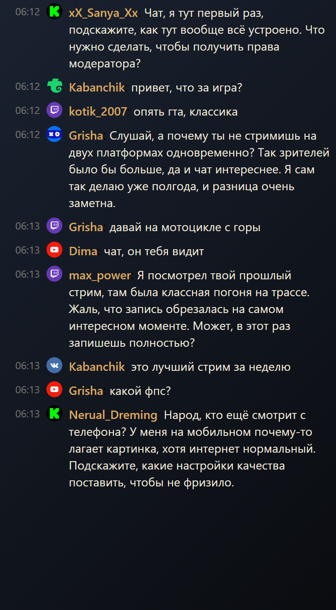

<div align="center">


# StreamVi Chat Overlay

**Прозрачное окно чата StreamVi поверх любой игры в Windows. Чат висит над игрой, мышь проходит сквозь него в игру, ничего больше не меняется.**

[](LICENSE)


[English](README.md) · **Русский**



</div>

> **Неофициальный проект.** Это личный инструмент, он не связан со StreamVi, не одобрен и не спонсируется ими. Внутри нет кода, логотипов или аккаунтов StreamVi — приложение просто открывает ссылку на виджет чата, которую вы указываете сами. StreamVi и его товарные знаки принадлежат их владельцам.

## Что это

У StreamVi есть виджет чата для OBS и док-панель для чтения чата. И то, и другое неудобно, когда игра на весь экран: док занимает место, а OBS мешает.

Это приложение кладёт **тот же виджет, который уходит в эфир**, в прозрачное окно без рамки поверх всех окон. Когда оверлей заблокирован, Windows пропускает все клики мыши сквозь него в игру; когда разблокирован — окно можно двигать, растягивать и настраивать. Аналог [Transparent Twitch Chat Overlay](https://github.com/baffler/Transparent-Twitch-Chat-Overlay), но для виджета StreamVi и без браузерного дока.

## Возможности

- **Любая ссылка на виджет StreamVi** — вариант `mode=widget`, который идёт в эфир (без поля ввода, с прозрачным фоном), или любой другой пресет.
- **Настоящий click-through** — заблокированный оверлей не забирает фокус и не съедает клики.
- **Перенос и размер** — полоса для перетаскивания и угол для растягивания в режиме редактирования; позиция и размер запоминаются.
- **Горячие клавиши работают из игры** — закрепить, скрыть, перезагрузить, масштаб, демо.
- **Настройки вида** — время, иконки платформ, ники, тема сообщений, выравнивание, анимация, отступ.
- **Цвета** — текст, ник, плашка под сообщением (с прозрачностью) и фон чата (с прозрачностью).
- **Масштаб** — 80–250 %: горячими клавишами, кнопками на полосе или в настройках.
- **Свой звук уведомления** — любой локальный аудиофайл или встроенный звук виджета.
- **Не попадает в OBS** — `WDA_EXCLUDEFROMCAPTURE` по умолчанию прячет оверлей от захвата экрана.
- **Демо-режим** — встроенная симуляция чата с настоящими иконками платформ и длинными сообщениями: можно настроить вид, не выходя в эфир.
- **Портативный конфиг** — всё в `config.json` рядом с приложением; без телеметрии и облака.

## Горячие клавиши

| Действие | Клавиши |
|---|---|
| Заблокировать / разблокировать (клики в игру) | `Ctrl+Alt+L` |
| Показать / скрыть | `Ctrl+Alt+H` |
| Перезагрузить чат | `Ctrl+Alt+R` |
| Сбросить позицию и размер | `Ctrl+Alt+0` |
| Масштаб больше / меньше | `Ctrl+Alt+=` / `Ctrl+Alt+-` |
| Демо-чат (симуляция) | `Ctrl+Alt+D` |
| Настройки | `Ctrl+Alt+S` |

## Установка

Нужны Windows 10/11 и [Node.js](https://nodejs.org/) 20+.

```bash
git clone https://github.com/timoncool/streamvi-chat-overlay.git
cd streamvi-chat-overlay
npm install
```

Запуск: `start.cmd` (или `start.vbs` — без окна консоли). При первом запуске откроются настройки — вставьте ссылку на чат StreamVi в поле **«Ссылка на чат StreamVi»** и нажмите «Сохранить».

Собрать портативную папку:

```bash
npm run pack
```

Результат — `dist/StreamViOverlay-win32-x64/`.

## Как пользоваться в игре

1. Поставьте игру в режим **Borderless / Windowed**. Поверх эксклюзивного полного экрана оверлей не рисуется — это ограничение Windows, а не приложения.
2. `Ctrl+Alt+L` разблокирует оверлей: сверху появляется фиолетовая полоса с кнопками **Настройки**, **Закрепить**, **Демо**, **A-**, **A+**. Тяните за полосу, размер — за правый нижний угол.
3. `Ctrl+Alt+L` ещё раз — оверлей закреплён: полоса исчезает, мышь уходит в игру, чат остаётся сверху.
4. `Ctrl+Alt+D` включает демо-чат, повторное нажатие возвращает реальный виджет.

## OBS

По умолчанию оверлей скрыт от захвата экрана (`Настройки → Не показывать оверлей в захвате экрана`). Это работает для OBS Display Capture, Discord и записи экрана. При захвате через **Game Capture** оверлей и так не попадает в кадр. Выключите галочку, если хотите, чтобы зрители видели само окно чата.

## Примечания

- В ссылке на чат есть ваш личный токен StreamVi. Он хранится только в `config.json` на вашем компьютере и никуда не отправляется этим приложением.
- `config.json` создаётся рядом с исполняемым файлом (или рядом с `package.json` в режиме разработки) и исключён из git.
- Если трансляция не запущена, StreamVi показывает заглушку («Чтобы чат заработал, запусти трансляцию…»). Это состояние виджета, а не ошибка оверлея.
- При включённом HDR прозрачные окна могут выглядеть бледно; выключите HDR для игры, если оверлей выглядит неправильно.

## Лицензия

MIT — см. [LICENSE](LICENSE).
